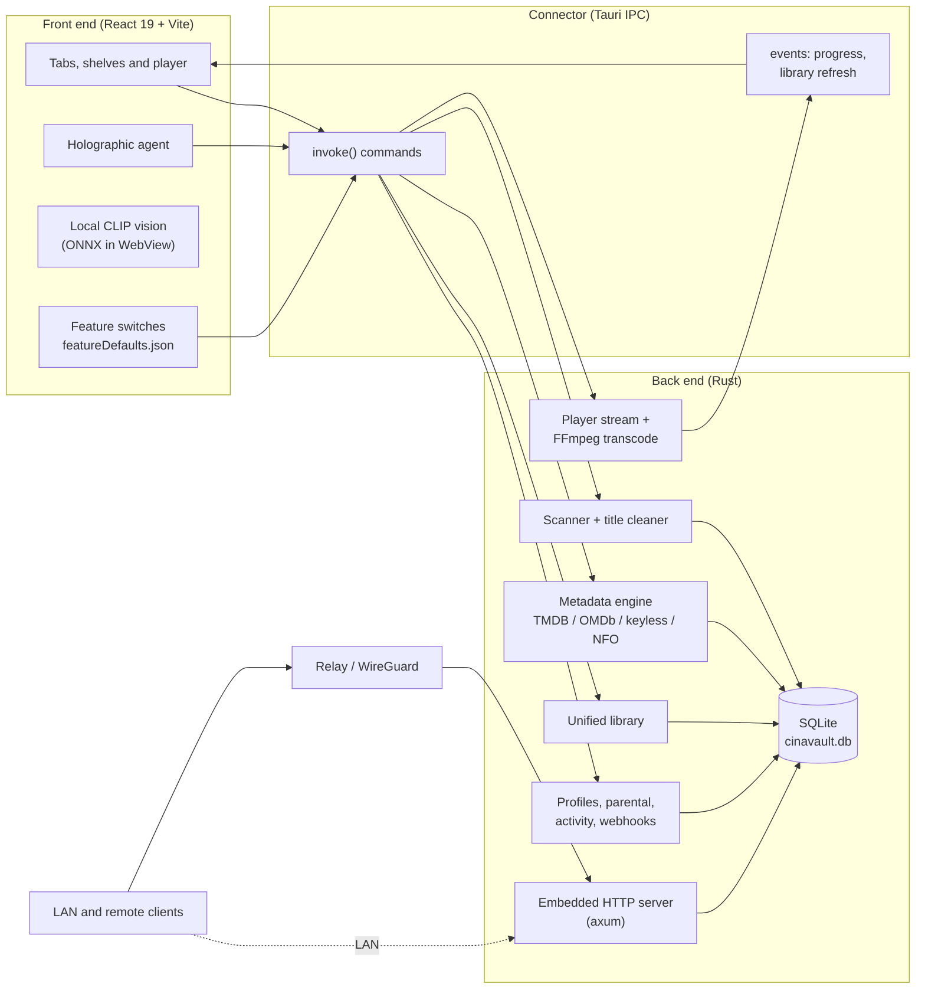
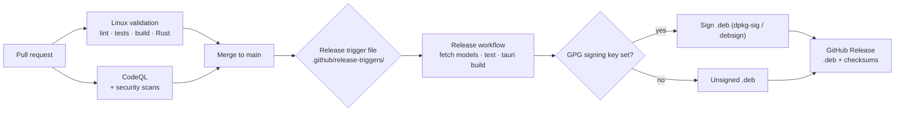

<p align="center">
  
</p>

<h1 align="center">CinaVault Premium — Linux Edition</h1>

<p align="center">
  A Debian/Linux media center and personal media server, built for Zorin OS: one library across every drive,
  NAS and cloud folder, a built-in player, offline AI identification and a holographic assistant.
</p>

<p align="center">
  <b>Debian / Zorin OS edition</b> · Tauri 2 · Rust · React 19 · SQLite
</p>

> **Status:** this repository holds the Linux edition's rules, guidelines and build scaffolding.
> The application source is being ported from the Windows reference
> ([johngraven75/CinaVault-Premium](https://github.com/johngraven75/CinaVault-Premium)) and lands through
> pull requests. Windows Premium remains the functional and visual reference
> (see [docs/MASTER_BUILD_COMPLETION_GATE.md](docs/MASTER_BUILD_COMPLETION_GATE.md)).

---

## Contents

- [Highlights](#highlights)
- [Architecture](#architecture)
- [Getting started](#getting-started)
- [Testing](#testing)
- [Build and release pipeline](#build-and-release-pipeline)
- [Repository layout](#repository-layout)
- [Documentation](#documentation)

## Highlights

| Area | What you get |
|---|---|
| **Unified library** | Local drives, NAS shares and cloud folders are scanned into one library, and each work appears once, shown as its best copy. |
| **Metadata** | TMDB, OMDb and Fanart (with your keys); TVMaze, Cinemeta and others without keys; Kodi `.nfo` import and release-name cleanup. |
| **Offline AI** | A bundled CLIP vision model identifies films and checks posters with no account, key or network ([docs](docs/LOCAL_AI.md)). |
| **Holographic agent** | A 3D animated assistant that can search, play and manage the library. |
| **Built-in player** | Direct play when the file can be decoded, and on-the-fly H.264/AAC transcoding (with VA-API / hardware encoders) when it can't. Resume, skip intro/credits, next up and gapless. |
| **Media server** | An embedded HTTP server for LAN and remote devices, with accounts, API keys, a bandwidth cap, a cache layer and an optional relay or WireGuard tunnel. |
| **Households** | Profiles with their own progress and watchlist, parental controls behind a PIN, an activity log and webhooks. |
| **Discovery** | Continue Watching, Watchlist, Trending, Recommendations, Similar Titles, Genre Radio and New Releases. |
| **More** | Live TV (IPTV), Google Cast, downloads, duplicate finder, and Jellyfin/Emby/Plex plugin bridges. |

## Architecture

The app is a Tauri 2 desktop shell. A React front end talks to a Rust back end through typed IPC commands, and the same back end serves other devices over HTTP.



On Linux, user data follows the XDG Base Directory spec: configuration in `~/.config/cinavault`, the library database and media cache in `~/.local/share/cinavault`, and transient data in `~/.cache/cinavault`.

## Getting started

**Requirements:** Zorin OS 17 (or Ubuntu 22.04+/Debian 12+), Node.js 22, the Rust stable toolchain, and the [Tauri 2 Linux prerequisites](https://v2.tauri.app/start/prerequisites/).

Install the system build dependencies:

```bash
sudo apt-get update
sudo apt-get install -y \
  libwebkit2gtk-4.1-dev \
  libappindicator3-dev \
  librsvg2-dev \
  patchelf \
  libssl-dev \
  libgtk-3-dev \
  libglib2.0-dev \
  build-essential curl file
```

Then build and run:

```bash
git clone https://github.com/johngraven75/cinavault-premium-linux.git
cd cinavault-premium-linux
npm ci
npm run fetch:ai-models     # bundles the offline vision model (about 149 MB)
npm run tauri:dev:linux     # run the app in development
npm run tauri:build:linux   # build the .deb package
```

Optional metadata keys (TMDB, OMDb, Fanart and others) are entered in the first-run wizard and stored through the Secret Service API (GNOME Keyring / libsecret), never in the repository.

## Testing

| Command | What it checks |
|---|---|
| `npm run lint` | TypeScript type check |
| `npm test` | Contract gates and every Node test suite (features, discovery, player, server and profiles, library, holographic UI, local vision, and others) |
| `cargo test --manifest-path src-tauri/Cargo.toml` | Rust unit and server integration tests |
| `npm run verify:contracts` · `npm run scan:preventive` | Shared front/back-end contracts and preventive risk scan |
| `npm run test:metadata-live` | Live TVMaze and Cinemeta poster acceptance (network) |

## Build and release pipeline



Package signing is wired to detached GPG signatures and turns on as soon as the signing key is configured ([docs/PACKAGE_SIGNING.md](docs/PACKAGE_SIGNING.md)). Until then, the `.deb` is published unsigned and users confirm the checksum on install.

## Repository layout

```text
.
├── src/                    React front end
│   ├── components/         tabs, shelves, player, holographic agent, setup wizard
│   ├── features/           switch defaults, catalog and settings panels
│   ├── services/           IPC wrappers (playback, discovery, collections, vision…)
│   └── store/              zustand app state
├── src-tauri/              Rust back end and Tauri config
│   └── src/                scanner, metadata, server, player, profiles, parental…
├── tests/                  Node test suites (run with npm test)
├── scripts/                build, signing, model-fetch and verification scripts
├── contracts/              versioned front/back-end contract fixtures
├── plugins/                Jellyfin, Emby and Plex bridge manifests
├── public/                 branding (models are fetched, not committed)
├── docs/                   guides, ADRs and policy pages
└── .github/                workflows, release triggers, templates
```

> Directories above marked as source (`src/`, `src-tauri/`, `tests/`, `scripts/`, `contracts/`, `plugins/`) arrive with the application port. This repository currently ships the rules, guidelines and CI scaffolding.

## Documentation

| Guide | Topic |
|---|---|
| [docs/README.md](docs/README.md) | Index of all documentation |
| [docs/MASTER_BUILD_COMPLETION_GATE.md](docs/MASTER_BUILD_COMPLETION_GATE.md) | What must pass before a build counts as complete |
| [docs/CARRY_FORWARD.md](docs/CARRY_FORWARD.md) | Registry of accepted features that every build must keep |
| [docs/DOMAIN_LANGUAGE.md](docs/DOMAIN_LANGUAGE.md) | Terms used for accounts, servers, clients and remote access |
| [docs/PACKAGE_SIGNING.md](docs/PACKAGE_SIGNING.md) | Signing the `.deb` package |
| [AGENTS.md](AGENTS.md) | Engineering rules for contributors |
| [SECURITY.md](SECURITY.md) | Reporting a vulnerability |
